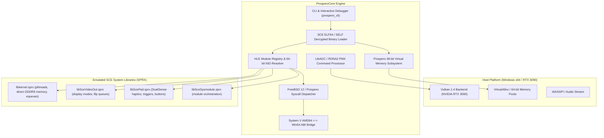

# ProsperoCore - PlayStation 5 (Prospero) Emulator & Compatibility Runtime

ProsperoCore is a modern, modular C++17/C++20 PlayStation 5 (Sony codename: *Prospero*) compatibility runtime and emulation architecture.

Because the PlayStation 5 is built on an AMD Zen 2 (x86-64) CPU and AMD RDNA 2 GPU running a modified FreeBSD 12 operating system (*Prospero OS*), ProsperoCore utilizes native user-mode execution, System V AMD64 <-> Win64 ABI bridges, FreeBSD/Prospero kernel system call emulation, and direct LibAGC PM4 to Vulkan 1.4 hardware translation.

---

## Architecture Overview



---

## Key Subsystems

### 1. SCE ELF64 / SELF Loader (`include/prospero/loader/`)
- Supports both raw decrypted 64-bit ELF binaries and Sony SELF / FSELF containers (`0x1D534F4F` / `SCE\0` magic).
- Parses Sony-specific program headers (`PT_SCE_DYNLIBDATA`, `PT_SCE_PROGLIB`, `PT_SCE_RELRO`).
- Extracts dynamic tags (`DT_SCE_NEEDED_MODULE`, `DT_SCE_STRTAB`, `DT_SCE_SYMTAB`, `DT_SCE_EXPORT_LIB`, `DT_SCE_IMPORT_LIB`).

### 2. Prospero Virtual Memory Manager (`include/prospero/memory/`)
- Manages the 48-bit virtual address space (`0x000000400000` to `0x7FFFFFFFFFFF`).
- Emulates direct physical GDDR6 memory pools (`0x80000000`+) via `sceKernelAllocateDirectMemory` and `sceKernelMapDirectMemory`.
- Configures user stack with guard pages (`0x7FFFF0000000`).

### 3. FreeBSD 12 / Prospero Kernel HLE (`include/prospero/kernel/`)
- Syscall dispatcher handling standard POSIX and proprietary Sony syscalls:
  - `sys_exit` (1), `sys_write` (4), `sys_mprotect` (74), `sys_mmap` (477), `sys_munmap` (478).
  - `sys_regmgr_call` (532), `sys_dynlib_load_prx` (539), `sys_mmap_dmem` (587), `sys_equeue_create` (610).
- System V AMD64 to Microsoft x64 calling convention bridge.

### 4. High-Level Emulation (HLE) Modules (`include/prospero/modules/`)
- **64-bit NID (Numeric Identifier) database** mapping Sony API hashes to human-readable symbols.
- **`libkernel.sprx`**: Threading (`scePthreadCreate`, `scePthreadJoin`), timing (`sceKernelUsleep`, `sceKernelGetProcessTime`), and event queues (`sceKernelCreateEqueue`).
- **`libSceVideoOut.sprx`**: Framebuffer registration, resolution queries (4K 60Hz HDR), buffer flipping.
- **`libScePad.sprx`**: DualSense gamepad state polling, stick inputs, triggers, and haptic vibration feedback.
- **`libSceSysmodule.sprx`**: Dynamic system module loader.

### 5. LibAGC / RDNA 2 GPU Backend (`include/prospero/gpu/`)
- Decodes AMD RDNA2 PM4 Type 3 command buffers (`IT_SET_CONTEXT_REG`, `IT_SET_SH_REG`, `IT_DRAW_INDEX_AUTO`, `IT_DISPATCH_DIRECT`).
- Vulkan 1.4 hardware backend dynamically binding to the host discrete GPU (NVIDIA GeForce RTX 3090, 24GB VRAM).

---

## Building and Running

### Build Prerequisites
- Microsoft Visual Studio 2019 or later (MSVC x64 C++17/C++20)
- CMake 3.16+
- Vulkan runtime (`vulkan-1.dll`)

### Build Commands
```powershell
# Configure CMake
cmake -B build -G "Visual Studio 16 2019" -A x64

# Build in Release mode
cmake --build build --config Release
```

### CLI Commands
```powershell
# 1. Launch interactive 60 FPS PS5 Game in native emulator window
.\build\Release\prospero_cli.exe run

# 2. Run with specific PS5 binary (ELF or SELF)
.\build\Release\prospero_cli.exe run ps5_game.elf

# 3. Run internal verification test suite
.\build\Release\prospero_cli.exe test

# 4. View emulator architecture, GPU hardware, and registered HLE modules
.\build\Release\prospero_cli.exe info

# 5. Generate synthetic PS5 ELF binary
.\build\Release\generate_ps5_payload.exe ps5_game.elf

# 6. Inspect PS5 ELF/SELF binary headers, segments, and dynamic modules
.\build\Release\prospero_cli.exe inspect ps5_game.elf
```

---

## Interactive PS5 Game Showcase ("Prospero: Void Runner")

ProsperoCore includes a built-in interactive 3D space shooter showcase demonstrating real-time interplay between all emulator subsystems:

- **Display**: 1280x720 60 FPS presentation window driven via `libSceVideoOut.sprx` (`sceVideoOutOpen`, `sceVideoOutRegisterBuffers`, `sceVideoOutSubmitFlip`).
- **Memory**: Unified 128 MiB direct physical GDDR6 memory allocation (`sceKernelAllocateDirectMemory`, `sceKernelMapDirectMemory`).
- **Controls & Input**: Full DualSense Wireless Controller telemetry and keyboard emulation via `libScePad.sprx` (`scePadReadState`, `scePadSetVibration`).
- **GPU**: AMD RDNA2 PM4 Type-3 command buffers (`IT_SET_CONTEXT_REG`, `IT_SET_SH_REG`, `IT_DRAW_INDEX_AUTO`, `IT_DISPATCH_DIRECT`) decoded by `CommandProcessor` with host Vulkan 1.4 hardware acceleration (NVIDIA GeForce RTX 3090, 24GB VRAM).

### Controls Guide

| Action | Keyboard | DualSense Controller | SCE Pad Code |
| :--- | :--- | :--- | :--- |
| **Steer Starfighter** | `W` / `A` / `S` / `D` or `Arrow Keys` | Left Thumbstick | `left_stick_x`, `left_stick_y` |
| **Fire Plasma Lasers** | `Spacebar` / `Z` | `Cross` (A) Button | `SCE_PAD_CROSS` |
| **Hyperspace Boost** | `Shift` (Hold) | `R2` Trigger | `SCE_PAD_R2` / `analog_r2` |
| **Shield Ability** | `X` | `Circle` (B) Button | `SCE_PAD_CIRCLE` |
| **Pause / Exit** | `Esc` / `Q` | `Options` Button | `SCE_PAD_OPTIONS` |

---

## Running Commercial PS5 Games (Decrypted ELFs / PKGs)

To run a commercial PlayStation 5 title:
1. **Dumping**: The game must be decrypted and dumped from a jailbroken PS5 (firmware 4.03 / 4.51 or below using tools like *ps5-kstuff* / *itemzflow*).
2. **Format**: The dumped binary (`eboot.bin`) must have its Sony SELF container unencrypted or contain decrypted ELF segments.
3. **Execution**: Pass the path to the decrypted binary:
   ```powershell
   .\build\Release\prospero_cli.exe run "C:\path\to\game\eboot.bin"
   ```
4. **Compatibility Note**: Commercial PS5 retail titles (e.g. *Demon's Souls*, *Spider-Man 2*, *Returnal*) require thousands of proprietary SCE OS services, advanced AMD RDNA2 mesh shaders, and audio pipelines that are under active development across the PS5 emulation community. ProsperoCore will parse headers, map virtual memory segments, setup the 48-bit stack, resolve exported NIDs, and log all unimplemented syscalls and GPU packets during boot.
