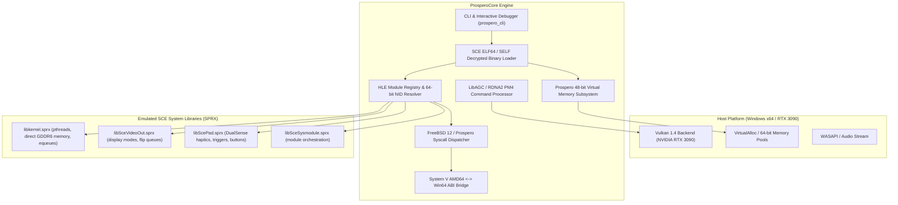

# ProsperoCore - PlayStation 5 (Prospero) Emulator & Compatibility Runtime

ProsperoCore is a modern, modular C++17/C++20 PlayStation 5 (Sony codename: *Prospero*) compatibility runtime and emulation architecture.

Because the PlayStation 5 is built on an AMD Zen 2 (x86-64) CPU and AMD RDNA 2 GPU running a modified FreeBSD 12 operating system (*Prospero OS*), ProsperoCore utilizes native user-mode execution, System V AMD64 <-> Win64 ABI bridges, FreeBSD/Prospero kernel system call emulation, and direct LibAGC PM4 to Vulkan 1.4 hardware translation.

---

## Architecture Overview



---

## Key Subsystems

### 1. SCE ELF64 / SELF Loader (`include/prospero/loader/`)
- Supports both raw decrypted 64-bit ELF binaries and Sony SELF / FSELF containers (`0x1D534F4F` / `SCE\0` magic).
- Parses Sony-specific program headers (`PT_SCE_DYNLIBDATA`, `PT_SCE_PROGLIB`, `PT_SCE_RELRO`).
- Extracts dynamic tags (`DT_SCE_NEEDED_MODULE`, `DT_SCE_STRTAB`, `DT_SCE_SYMTAB`, `DT_SCE_EXPORT_LIB`, `DT_SCE_IMPORT_LIB`).

### 2. Prospero Virtual Memory Manager (`include/prospero/memory/`)
- Manages the 48-bit virtual address space (`0x000000400000` to `0x7FFFFFFFFFFF`).
- Emulates direct physical GDDR6 memory pools (`0x80000000`+) via `sceKernelAllocateDirectMemory` and `sceKernelMapDirectMemory`.
- Configures user stack with guard pages (`0x7FFFF0000000`).

### 3. FreeBSD 12 / Prospero Kernel HLE (`include/prospero/kernel/`)
- Syscall dispatcher handling standard POSIX and proprietary Sony syscalls:
  - `sys_exit` (1), `sys_write` (4), `sys_mprotect` (74), `sys_mmap` (477), `sys_munmap` (478).
  - `sys_regmgr_call` (532), `sys_dynlib_load_prx` (539), `sys_mmap_dmem` (587), `sys_equeue_create` (610).
- System V AMD64 to Microsoft x64 calling convention bridge.

### 4. High-Level Emulation (HLE) Modules (`include/prospero/modules/`)
- **64-bit NID (Numeric Identifier) database** mapping Sony API hashes to human-readable symbols.
- **`libkernel.sprx`**: Threading (`scePthreadCreate`, `scePthreadJoin`), timing (`sceKernelUsleep`, `sceKernelGetProcessTime`), and event queues (`sceKernelCreateEqueue`).
- **`libSceVideoOut.sprx`**: Framebuffer registration, resolution queries (4K 60Hz HDR), buffer flipping.
- **`libScePad.sprx`**: DualSense gamepad state polling, stick inputs, triggers, and haptic vibration feedback.
- **`libSceSysmodule.sprx`**: Dynamic system module loader.

### 5. LibAGC / RDNA 2 GPU Backend (`include/prospero/gpu/`)
- Decodes AMD RDNA2 PM4 Type 3 command buffers (`IT_SET_CONTEXT_REG`, `IT_SET_SH_REG`, `IT_DRAW_INDEX_AUTO`, `IT_DISPATCH_DIRECT`).
- Vulkan 1.4 hardware backend dynamically binding to the host discrete GPU (NVIDIA GeForce RTX 3090, 24GB VRAM).

---

## Building and Running

### Build Prerequisites
- Microsoft Visual Studio 2019 or later (MSVC x64 C++17/C++20)
- CMake 3.16+
- Vulkan runtime (`vulkan-1.dll`)

### Build Commands
```powershell
# Configure CMake
cmake -B build -G "Visual Studio 16 2019" -A x64

# Build in Release mode
cmake --build build --config Release
```

### CLI Commands
```powershell
# 1. Run internal verification test suite
.\build\Release\prospero_cli.exe test

# 2. View emulator architecture, GPU hardware, and registered HLE modules
.\build\Release\prospero_cli.exe info

# 3. Generate a synthetic PS5 test ELF binary
.\build\Release\generate_ps5_payload.exe sample_ps5_payload.elf

# 4. Inspect PS5 ELF/SELF binary headers, segments, and dynamic modules
.\build\Release\prospero_cli.exe inspect sample_ps5_payload.elf

# 5. Load and execute binary in the Prospero virtual memory sandbox
.\build\Release\prospero_cli.exe run sample_ps5_payload.elf
```
